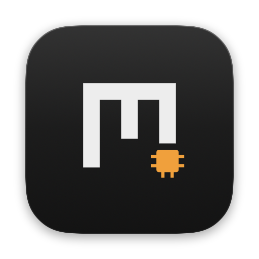
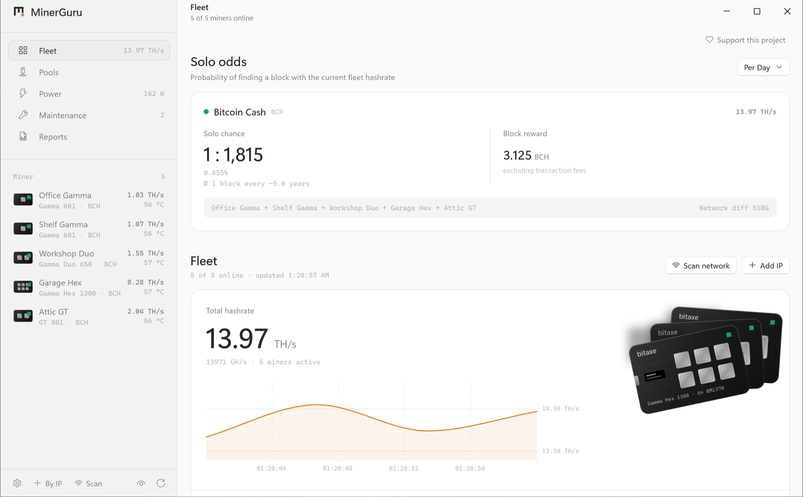
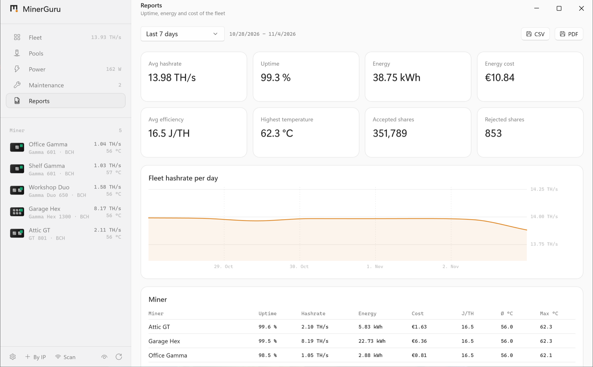
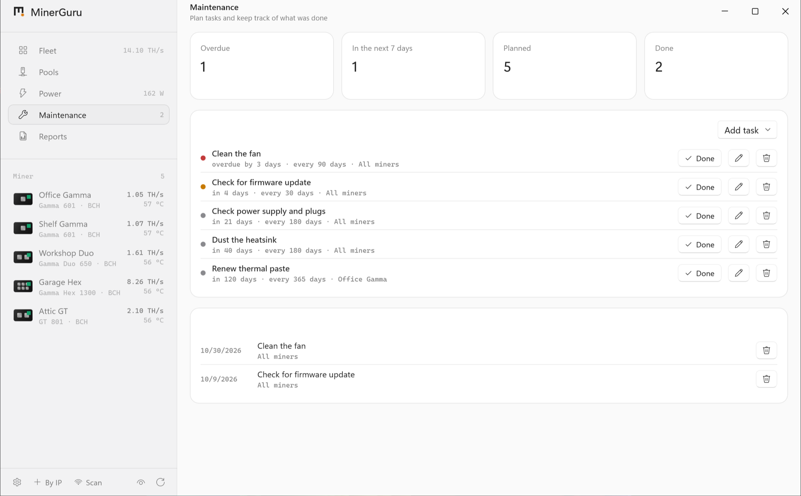

<p align="center">
  
</p>

<h1 align="center">MinerGuru for Windows</h1>

<p align="center">
  <b>Your Bitaxe and NerdQAxe miners, watched from the notification area.</b><br>
  The same app as on the Mac, built natively with WinUI.
</p>

<p align="center">
  <a href="https://github.com/GuruMeditationSoftware/minerguru-windows/releases/latest/download/MinerGuru-x64.exe"><b>Download for Windows</b></a>
  &nbsp;·&nbsp;
  <a href="https://github.com/GuruMeditationSoftware/minerguru">Mac</a>
  &nbsp;·&nbsp;
  <a href="https://github.com/GuruMeditationSoftware/minerguru-android">Android</a>
  &nbsp;·&nbsp;
  <a href="https://minerguru.github.io">Website</a>
</p>

<p align="center">
  <sub>Windows 11 · x64 and Arm · Free · No account</sub>
</p>

<p align="center">
  <picture>
    <source media="(prefers-color-scheme: dark)" srcset=".github/readme/windows-overview-dark.png">
    
  </picture>
</p>

MinerGuru talks to AxeOS and NerdOS directly over your local network. No cloud in between, no account, no tracking. It sits in the notification area and keeps watching your miners while its window is closed.

## Features

- **Finds your miners.** Scans your network in seconds, or add a miner by IP address or hostname.
- **Live fleet dashboard.** Total hashrate with its history, power, efficiency in J/TH, shares, best difficulty and pool latency.
- **Always running.** Lives in the notification area and keeps checking while the window is closed.
- **Tune and control.** Frequency, core voltage and fan for Eco, Standard and Boost. Restart or rename in a click. Overclocking is always at your own risk.
- **Pool management.** A pool library, assignment to every slot of every miner, a latency test before you switch, and scheduled switching, for example to a solo pool at night.
- **Solo mining odds.** Your chance of finding a block per day, month or year, for BTC and BCH.
- **Alerts.** When a miner goes offline, overheats, stops finding shares, falls back to its backup pool or its payout address changes. Also by email through your own mail server.
- **History and reports.** Every minute for two weeks, hourly for three years, stored locally. Reports on uptime, energy and cost as PDF or CSV.
- **Maintenance.** Plan fan cleaning, thermal paste and firmware checks, and get a reminder when they are due.
- **Widgets.** Fleet and solo odds on the Windows widget board (needs Developer Mode, see below).
- **Safe by default.** A read-only mode, a local log of every change, and an optional automatic restart at most once an hour.
- **Private by design.** Once a day MinerGuru asks GitHub for a new version, and you can turn that off.

Works with every miner running AxeOS or NerdOS, including Bitaxe Max, Ultra, Supra, Gamma, GT and Hex, NerdAxe, NerdQAxe and NerdOctaxe. Board, chip count and ASIC are detected automatically.

<table>
  <tr>
    <td width="50%">
      <picture>
        <source media="(prefers-color-scheme: dark)" srcset=".github/readme/windows-reports-dark.png">
        
      </picture>
    </td>
    <td width="50%">
      <picture>
        <source media="(prefers-color-scheme: dark)" srcset=".github/readme/windows-maintenance-dark.png">
        
      </picture>
    </td>
  </tr>
  <tr>
    <td align="center"><sub>Reports as PDF or CSV</sub></td>
    <td align="center"><sub>Maintenance tasks with reminders</sub></td>
  </tr>
</table>

## Download and install

Windows 11:
- **[MinerGuru-x64.exe](https://github.com/GuruMeditationSoftware/minerguru-windows/releases/latest/download/MinerGuru-x64.exe)** for most PCs
- **[MinerGuru-arm64.exe](https://github.com/GuruMeditationSoftware/minerguru-windows/releases/latest/download/MinerGuru-arm64.exe)** for Arm PCs

1. Run the installer. It is not signed, so SmartScreen asks you to confirm: click **More info**, then **Run anyway**.
2. Open MinerGuru from the Start menu and let it scan your network for miners.

Smart App Control blocks unsigned apps and has no exception for a single app. If it is on, turn it off under **Windows Security → App & browser control** to use MinerGuru.

**Widgets** for the widget board need Developer Mode, because Windows only accepts widgets from unsigned apps there. Turn it on under **Settings → System → For developers**, then switch the widgets on in MinerGuru's settings. Without it, MinerGuru works as usual from the notification area.

Every release lists its SHA-256 checksums in `SHA256SUMS.txt`. What changed: [Releases](https://github.com/GuruMeditationSoftware/minerguru-windows/releases).

## MinerGuru on your other devices

| Platform | Requirements | Download |
| --- | --- | --- |
| **Windows** (this repository) | Windows 11, x64 or Arm | [x64](https://github.com/GuruMeditationSoftware/minerguru-windows/releases/latest/download/MinerGuru-x64.exe) · [Arm64](https://github.com/GuruMeditationSoftware/minerguru-windows/releases/latest/download/MinerGuru-arm64.exe) |
| [**Mac**](https://github.com/GuruMeditationSoftware/minerguru) | macOS 14 or later, Apple Silicon | [MinerGuru.dmg](https://github.com/GuruMeditationSoftware/minerguru/releases/latest/download/MinerGuru.dmg) |
| [**Android**](https://github.com/GuruMeditationSoftware/minerguru-android) | Android 12 or later | [MinerGuru.apk](https://github.com/GuruMeditationSoftware/minerguru-android/releases/latest/download/MinerGuru.apk) |

## Support the project

MinerGuru is free and shows no ads. If it keeps your miners happy, a few sats keep the updates coming.

<table>
  <tr>
    <td align="center"><br><b>Bitcoin</b></td>
    <td align="center"><br><b>Bitcoin Cash</b></td>
  </tr>
</table>

**BTC**

```text
bc1qc6xpuwkys8jsjt439tfw2eu3fctkx7ad0hkehe
```

**BCH**

```text
bitcoincash:qruvqq2x9vyd9gykre058r4lda4gulpres33nr9aml
```

## Feedback

Found a bug or have an idea? Open an [issue](https://github.com/GuruMeditationSoftware/minerguru/issues) in the Mac repository. It collects feedback for all three apps.

## License

Freeware, see [LICENSE.txt](LICENSE.txt). This repository holds the downloads only.
