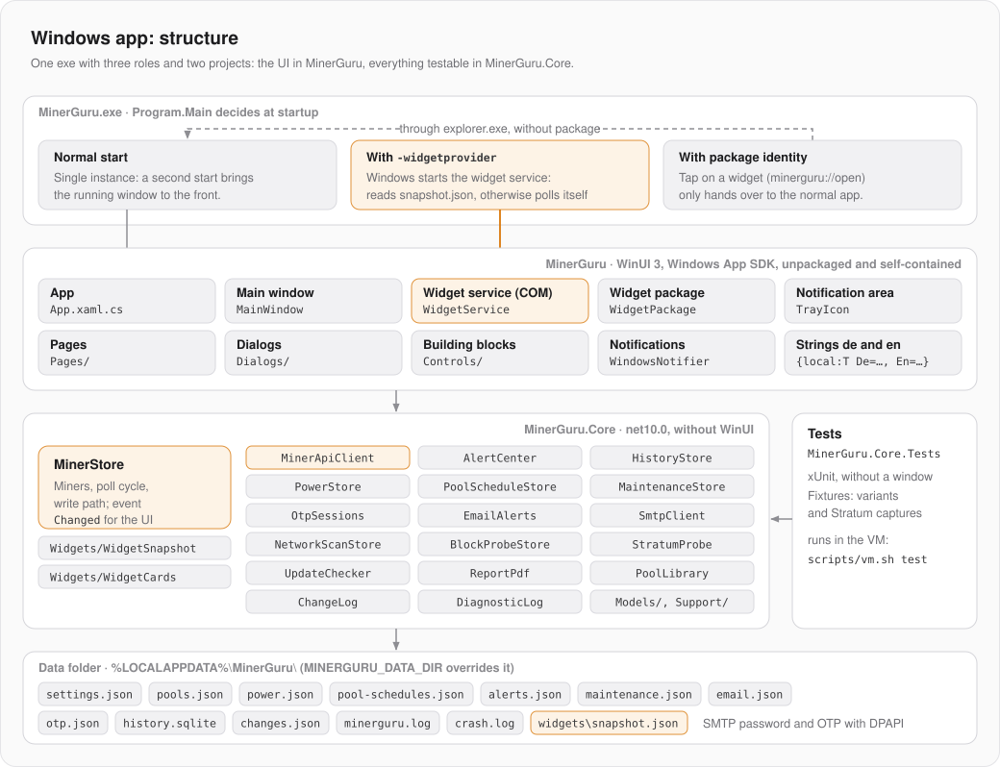
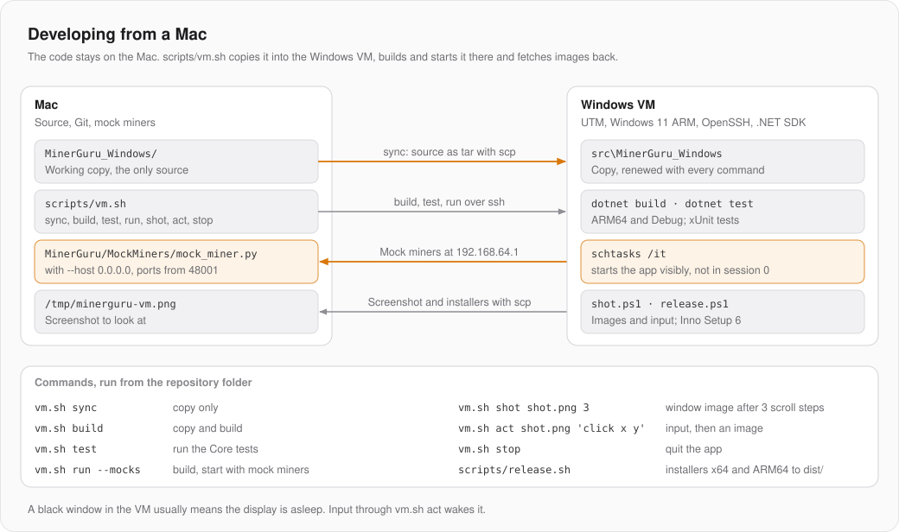

# Windows app: architecture

What all three apps have in common (miner API, poll cycle, write path, watchdog, mock miners) is in the Mac repository under [`docs/FUNDAMENTALS.md`](https://github.com/GuruMeditationSoftware/minerguru/blob/main/docs/FUNDAMENTALS.md). It also has the table of which class here matches which Mac class. This page describes only the Windows app.

| | |
|---|---|
| Language, UI | C#, WinUI 3 with Windows App SDK 2.6 |
| Runtime | .NET 10, Windows 10 2004 (19041) or later, x64 and ARM64 |
| Packaging | unpackaged and self-contained: the exe runs without MSIX and without a runtime installer |
| Projects | `src/MinerGuru` (WinUI), `src/MinerGuru.Core` (no WinUI), `tests/MinerGuru.Core.Tests` (xUnit) |
| Libraries | Microsoft.Data.Sqlite, ProtectedData (DPAPI), QRCoder |
| Installer | Inno Setup 6, per user without admin rights, unsigned |

Development happens on the Mac; building, testing and running happen in a Windows VM (see [Developing from a Mac](#developing-from-a-mac)).

## Structure



**The split into two projects is the most important rule.** Everything that can be checked without a window belongs in `MinerGuru.Core`: models, API client, `MinerStore`, watchdog, history, schedules, PDF reports, widget cards. `MinerGuru` contains only what needs WinUI or Win32. That way the tests run without a window and without the Windows App SDK.

| Folder | Contents |
|---|---|
| `src/MinerGuru/Pages/` | one page per area: fleet, miners, pools, power, maintenance, reports, settings |
| `src/MinerGuru/Dialogs/` | Dialogs: add miner, scan, edit pool, confirm, one-time code, … |
| `src/MinerGuru/Controls/` | Building blocks: `DeviceCard`, charts, cards, `TrayIcon`, palette |
| `src/MinerGuru/Widgets/` | Widget service, package registration, manifest template |
| `src/MinerGuru/Styles/Theme.xaml` | Colors and type roles |
| `src/MinerGuru.Core/Services/` | `MinerStore` and all services |
| `src/MinerGuru.Core/Models/` | Value types and pure logic |
| `src/MinerGuru.Core/Widgets/` | `WidgetSnapshot`, `WidgetCards` (Adaptive Cards) |
| `installer/MinerGuru.iss` | Inno Setup script |
| `scripts/` | `vm.sh`, `release.sh` and the PowerShell helpers for the VM |

## One exe, three roles

`Program.Main` replaces the entry point generated by XAML (`DISABLE_XAML_GENERATED_MAIN`) and decides at startup:

1. **Normal start:** the WinUI app. `App.OnLaunched` registers as the single instance with `AppInstance.FindOrRegisterForKey("main")`. A second start forwards its activation to the running app (which may be sitting in the notification area) and exits.
2. **With `-widgetprovider`:** Windows starts the widget service, a COM server for the widget board.
3. **With package identity:** tapping a widget opens `minerguru://open` in the registered widget package. This start only hands over to the normal app through `explorer.exe`, because the normal app has to run without a package (its own single instance, its own data folder).

## State and UI

`MinerStore` (in Core) is created in `App.OnLaunched` on the UI thread, so its events arrive there. The UI does not bind through MVVM; it listens to `MinerStore.Changed` and updates itself. Questions to the user come into the store as delegates from the app: `Otp.Prompt` for the one-time code, `ConfirmWrite` for the confirmation before a write.

`MainWindow` has its own sidebar and a `Frame` that switches with `ContentFrame.Navigate(typeof(…Page))`. Every page needs a `.xaml` file: a code-only page makes `Frame.Navigate` crash without an error message.

Texts live in `src/MinerGuru.Core/Resources/Strings.resx` (English, the neutral language) and `Strings.de.resx` (German), in Core because models, alerts and widget cards build texts too. The build generates the class `MinerGuru.Strings` with one property per key, so code reads `Strings.Fleet` and a missing key is a compile error. Texts with values are composite formats: `string.Format(Strings.MinerAdded, name)`; the comment in `Strings.resx` names what `{0}`, `{1}` stand for. XAML uses the markup extension `{local:T Key=Fleet}`. `Lang.English` sets `Strings.Culture`; a language change in the settings takes effect after a restart. `LocalizationTests` check that both files have the same keys and placeholders and that every XAML key exists. Because the language is global, the tests do not run in parallel.

## Design

The app looks like the Mac app (graphite surfaces, one orange as the accent, the same board graphics) but uses Windows controls: `InfoBar`, `ContentDialog`, `NumberBox`. Light and dark follow the system; the board graphics stay dark in light mode too. Fonts: Segoe UI Variable and Cascadia Mono, because SF Pro and SF Mono are not licensed for Windows.

## Notification area and notifications

- Closing puts the app into the notification area. Monitoring and schedules keep running; quitting goes through the tray window (`TrayFlyoutWindow`).
- Notifications go through `Shell_NotifyIcon` (`WindowsNotifier`), not through `AppNotificationManager`, which refuses elevated processes. As a result the messages do not land in the notification center, and missed ones are gone.

## Widgets

Widgets need a package identity, and without a signature Windows grants it only in Developer Mode. That is why they are opt-in under Settings › Widgets:

- Without Developer Mode the switch is grayed out, with an explanation and a link to `ms-settings:developers`. The app only reads Developer Mode (`AllowDevelopmentWithoutDevLicense` in the registry) and never turns it on itself.
- When switched on, `WidgetPackage` registers the app folder as the loose package `MinerGuru.Widgets` (publisher `CN=MinerGuru`, unsigned, no admin rights). The manifest is generated from `AppxManifest.template.xml` in the app's language.
- After every cycle the app writes `widgets\snapshot.json`. The widget service builds Adaptive Cards from it (`WidgetCards`, in Core and tested). If the snapshot is older than 90 s, the service polls the miners itself, at most once a minute. When all widgets have been hidden for 10 min, it exits; Windows starts it again when needed.
- On offer: fleet (small, medium, large) and solo odds per coin.

## Storage

Everything lives in `%LOCALAPPDATA%\MinerGuru\`, which `MINERGURU_DATA_DIR` can redirect for tests and mocks:

| File | Contents |
|---|---|
| `settings.json` | Miner list and settings; a broken file is backed up, not overwritten |
| `pools.json`, `power.json`, `pool-schedules.json`, `alerts.json`, `maintenance.json` | State of the services |
| `email.json`, `otp.json` | SMTP password and one-time code sessions, encrypted with DPAPI for the Windows user |
| `history.sqlite` | Long-term history; `HistoryStore` opens the file per operation |
| `changes.json`, `minerguru.log` | Change log, diagnostic log |
| `crash.log` | Unhandled exceptions with stack trace (the event log only names the XAML module) |
| `widgets\snapshot.json` | For the widget service |

## Building on Windows directly

On Windows 11 (x64 or Arm64) the .NET 10 SDK is all you need:

```bash
dotnet build src\MinerGuru\MinerGuru.csproj -p:Platform=x64
```

```bash
dotnet test tests\MinerGuru.Core.Tests
```

The exe then sits in `src\MinerGuru\bin\x64\Debug\net10.0-windows10.0.26100.0\win-x64\`, on Arm accordingly with `ARM64` and `win-arm64`. The tests of `MinerGuru.Core` also run on macOS and Linux.

## Developing from a Mac



The VM is Windows 11 ARM in UTM with OpenSSH (PowerShell as the shell) and the .NET SDK. Its address is in `MINERGURU_VM` (`user@host`), in the environment or in `~/.config/minerguru/env` outside the repository. The Mac repository sits next to this one as `MinerGuru`. From the Mac:

```bash
python3 ../MinerGuru/MockMiners/mock_miner.py --host 0.0.0.0 --advertise 192.168.64.1
```

```bash
scripts/vm.sh run --mocks
```

```bash
scripts/vm.sh test
```

Switches for testing. They only work in debug builds: all of them go through `DebugSwitch` in Core, and a release reads no environment variable.

| Variable | Effect |
|---|---|
| `MINERGURU_THEME=light\|dark` | Force the color scheme |
| `MINERGURU_OPEN` | Open a page: `pools`, `power`, `settings`, `tray` or a miner address such as `:48004` |
| `MINERGURU_MOCK_MINERS=n` | Start with only the first n mock miners (the scan finds all of them) |
| `MINERGURU_SCAN_EXTRA` | Lets the scan find the mock ports (`vm.sh run --mocks` sets it itself, as well as a separate `MINERGURU_DATA_DIR`) |
| `MINERGURU_UPDATE_URL` | Check the update notice against a local server |
| `MINERGURU_DESK=1` | `vm.sh act` and `shot` capture the whole screen (notification area, notifications) |

`vm.sh run --mocks` overwrites `settings.json`, so don't check settings across such restarts.

## Release

Raise the version in `src/MinerGuru/MinerGuru.csproj` (`<Version>`), then run `scripts/release.sh`. In the VM it always builds x64 and ARM64 from scratch, creates the installers with Inno Setup, checks for personal traces and creates `dist/upload/windows/`. The search patterns live outside the repository (`MINERGURU_TRACES`, otherwise `~/.config/minerguru/traces`, one regular expression per line); without them the script aborts.

## Pitfalls

- `dotnet publish` leaves out the compiled XAML files (`.xbf`) and `MinerGuru.pri`; without them the app dies on start (0xc000027b). The `PublishXaml` target in the csproj copies them over.
- No `.pdb` in the package, and never build from an old `obj`: it contains the path `C:\Users\…` with the user name. The trace check then aborts.
- `JsonContent` sends chunked without `Content-Length`, and the firmware then reads an empty body. Use `StringContent` for writes.
- `SQLitePCLRaw.lib.e_sqlite3` is pinned to a newer version, because the bundled one has a known vulnerability.
- `ContentDialog` follows the Windows theme, not the app's: set `RequestedTheme = ActualTheme`. Width at most `ContentDialogMaxWidth`.
- Widgets: in Developer Mode Windows does not re-register the same package version, so the fourth version number is a hash of the manifest. Registering through `PackageManager` from the app hung; it runs through a hidden PowerShell. The board centers cards, hence `minHeight`. Tapping a widget asks "Switch apps?" every time; without that question the app would not get the foreground.
- In the VM: processes started over SSH run invisibly in session 0, which is why `vm.sh` starts the app with `schtasks /it`. When the display sleeps, WinUI windows are black. Smart App Control blocks unsigned test DLLs and must be off.
- In zsh, backticks inside double quotes are executed, including PowerShell's `` `r`n ``. Write PowerShell scripts as a local file and copy them.
