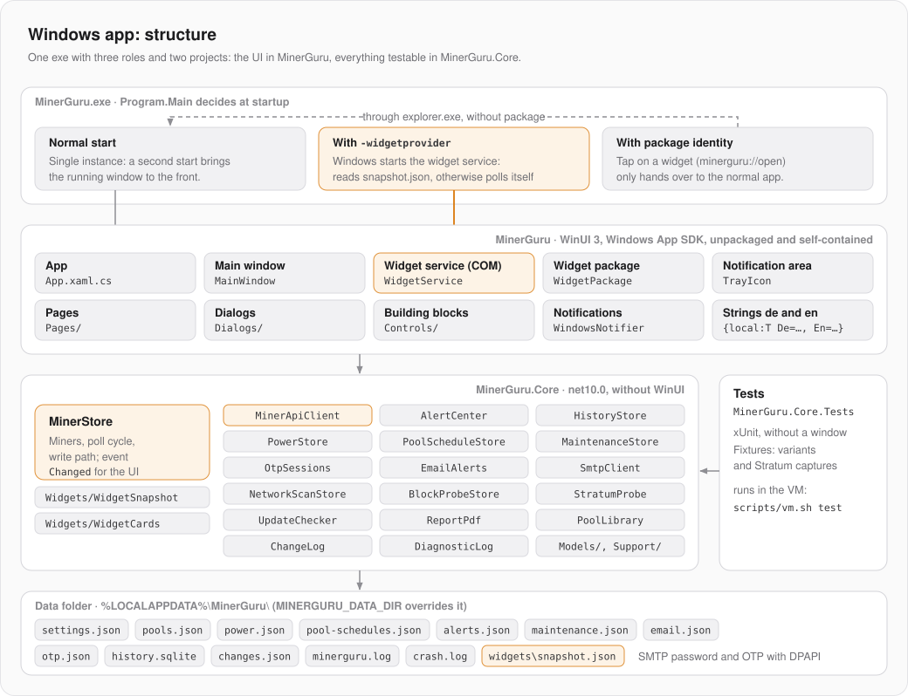
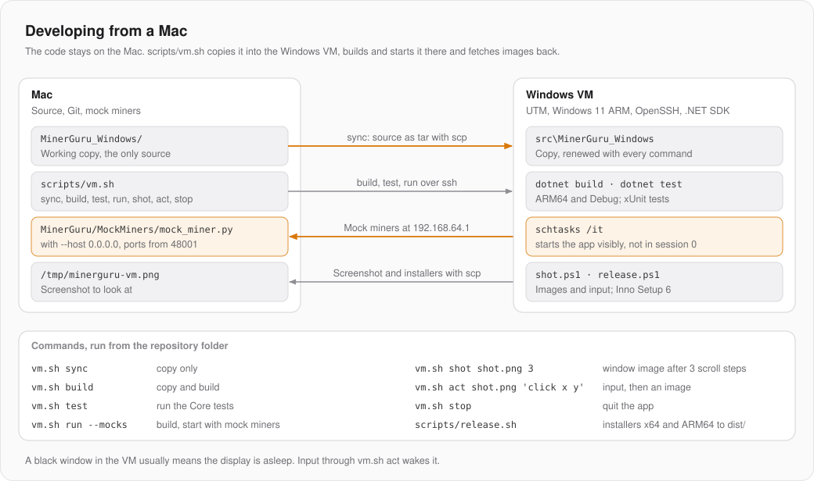

# Windows-App: Architektur

Was alle drei Apps gemeinsam haben (Miner-API, Abfragerunde, Schreibweg, Wächter, Mock-Miner), steht im Mac-Repo unter `MinerGuru/docs/GRUNDLAGEN.md`. Dort gibt es auch die Tabelle, welche Klasse hier welcher Mac-Klasse entspricht. Diese Seite beschreibt nur die Windows-App.

| | |
|---|---|
| Sprache, Oberfläche | C#, WinUI 3 mit Windows App SDK 2.6 |
| Laufzeit | .NET 10, ab Windows 10 2004 (19041), x64 und ARM64 |
| Verpackung | unpackaged und self-contained: die exe läuft ohne MSIX und ohne Laufzeit-Installer |
| Projekte | `src/MinerGuru` (WinUI), `src/MinerGuru.Core` (ohne WinUI), `tests/MinerGuru.Core.Tests` (xUnit) |
| Bibliotheken | Microsoft.Data.Sqlite, ProtectedData (DPAPI), QRCoder |
| Installer | Inno Setup 6, pro Benutzer ohne Admin, unsigniert |

Entwickelt wird auf dem Mac; gebaut, getestet und gestartet in einer Windows-VM (siehe [Entwickeln vom Mac aus](#entwickeln-vom-mac-aus)).

## Aufbau



**Die Trennung in zwei Projekte ist die wichtigste Regel.** Alles, was sich ohne Fenster prüfen lässt, gehört nach `MinerGuru.Core`: Modelle, API-Client, `MinerStore`, Wächter, Verlauf, Zeitpläne, PDF-Berichte, Widget-Karten. `MinerGuru` enthält nur, was WinUI oder Win32 braucht. So laufen die Tests ohne Fenster und ohne Windows App SDK.

| Ordner | Inhalt |
|---|---|
| `src/MinerGuru/Pages/` | eine Seite je Bereich: Flotte, Miner, Pools, Strom, Wartung, Berichte, Einstellungen |
| `src/MinerGuru/Dialogs/` | Dialoge: Miner hinzufügen, Scan, Pool bearbeiten, Bestätigen, Einmalcode, … |
| `src/MinerGuru/Controls/` | Bausteine: `DeviceCard`, Charts, Karten, `TrayIcon`, Palette |
| `src/MinerGuru/Widgets/` | Widget-Dienst, Paket-Registrierung, Manifest-Vorlage |
| `src/MinerGuru/Styles/Theme.xaml` | Farben und Schrift-Rollen |
| `src/MinerGuru.Core/Services/` | `MinerStore` und alle Dienste |
| `src/MinerGuru.Core/Models/` | Werttypen und reine Logik |
| `src/MinerGuru.Core/Widgets/` | `WidgetSnapshot`, `WidgetCards` (Adaptive Cards) |
| `installer/MinerGuru.iss` | Inno-Setup-Skript |
| `scripts/` | `vm.sh`, `release.sh` und die PowerShell-Helfer für die VM |

## Eine exe, drei Rollen

`Program.Main` ersetzt den von XAML erzeugten Einstieg (`DISABLE_XAML_GENERATED_MAIN`) und entscheidet beim Start:

1. **Normaler Start:** die WinUI-App. `App.OnLaunched` meldet sich per `AppInstance.FindOrRegisterForKey("main")` als einzige Instanz an. Ein zweiter Start leitet seine Aktivierung an die laufende App weiter (die vielleicht im Infobereich sitzt) und beendet sich.
2. **Mit `-widgetprovider`:** Windows startet den Widget-Dienst, einen COM-Server für das Widget-Board.
3. **Mit Paketidentität:** Ein Tipp aufs Widget öffnet `minerguru://open` im registrierten Widget-Paket. Dieser Start reicht nur über `explorer.exe` an die normale App weiter, die ohne Paket laufen muss (eigene Einzelinstanz, eigener Datenordner).

## Zustand und Oberfläche

`MinerStore` (in Core) wird in `App.OnLaunched` auf dem UI-Thread erzeugt, darum kommen seine Ereignisse dort an. Die Oberfläche bindet nicht per MVVM, sondern hört auf `MinerStore.Changed` und aktualisiert sich selbst. Rückfragen kommen als Delegates von der App in den Store: `Otp.Prompt` für den Einmalcode, `ConfirmWrite` für die Bestätigung vor dem Schreiben.

`MainWindow` hat eine eigene Seitenleiste und einen `Frame`, der per `ContentFrame.Navigate(typeof(…Page))` wechselt. Jede Seite braucht eine `.xaml`-Datei: Eine reine Code-Seite lässt `Frame.Navigate` ohne Fehlermeldung abstürzen.

Texte stehen als `L(de, en)` im Code und als `{local:T De=…, En=…}` in XAML.

## Design

Die App sieht aus wie die Mac-App (Graphit-Flächen, ein Orange als Akzent, dieselben Board-Grafiken), nutzt aber Windows-Bedienelemente: `InfoBar`, `ContentDialog`, `NumberBox`. Hell und dunkel folgen dem System, die Board-Grafiken bleiben auch hell dunkel. Schriften: Segoe UI Variable und Cascadia Mono, weil SF Pro und SF Mono auf Windows nicht erlaubt sind.

## Infobereich und Mitteilungen

- Schließen legt die App in den Infobereich. Überwachung und Zeitpläne laufen weiter, Beenden geht über das Tray-Fenster (`TrayFlyoutWindow`).
- Mitteilungen laufen über `Shell_NotifyIcon` (`WindowsNotifier`), nicht über `AppNotificationManager`: Der lehnt erhöhte Prozesse ab. Folge: Die Meldungen landen nicht im Info-Center, verpasste sind weg.

## Widgets

Widgets brauchen eine Paketidentität, und ohne Signatur gibt Windows die nur im Entwicklermodus. Deshalb sind sie ein Opt-in unter Einstellungen › Widgets:

- Ohne Entwicklermodus ist der Schalter ausgegraut, mit Erklärung und Link zu `ms-settings:developers`. Die App liest den Entwicklermodus nur (`AllowDevelopmentWithoutDevLicense` in der Registry) und schaltet ihn nie selbst.
- Eingeschaltet registriert `WidgetPackage` den App-Ordner als loses Paket `MinerGuru.Widgets` (Herausgeber `CN=MinerGuru`, unsigniert, ohne Admin). Das Manifest entsteht aus `AppxManifest.template.xml` in der Sprache der App.
- Die App schreibt nach jeder Runde `widgets\snapshot.json`. Der Widget-Dienst baut daraus Adaptive Cards (`WidgetCards`, in Core und getestet). Ist der Schnappschuss älter als 90 s, fragt der Dienst die Miner selbst, höchstens einmal pro Minute. Sind alle Widgets 10 min lang verborgen, beendet er sich; Windows startet ihn bei Bedarf neu.
- Angeboten werden Flotte (klein, mittel, groß) und Solo-Chance je Coin.

## Speicher

Alles liegt in `%LOCALAPPDATA%\MinerGuru\`, für Tests und Mocks umlenkbar mit `MINERGURU_DATA_DIR`:

| Datei | Inhalt |
|---|---|
| `settings.json` | Miner-Liste und Einstellungen; eine kaputte Datei wird gesichert, nicht überschrieben |
| `pools.json`, `power.json`, `pool-schedules.json`, `alerts.json`, `maintenance.json` | Zustand der Dienste |
| `email.json`, `otp.json` | SMTP-Passwort und Einmalcode-Sitzungen, per DPAPI für den Windows-Benutzer verschlüsselt |
| `history.sqlite` | Langzeit-Verlauf; `HistoryStore` öffnet die Datei je Vorgang |
| `changes.json`, `minerguru.log` | Änderungsprotokoll, Diagnose-Log |
| `crash.log` | unbehandelte Ausnahmen mit Stack (das Ereignisprotokoll nennt nur das XAML-Modul) |
| `widgets\snapshot.json` | für den Widget-Dienst |

## Direkt unter Windows bauen

Unter Windows 11 (x64 oder Arm64) genügt das .NET 10 SDK:

```bash
dotnet build src\MinerGuru\MinerGuru.csproj -p:Platform=x64
```

```bash
dotnet test tests\MinerGuru.Core.Tests
```

Die exe liegt danach unter `src\MinerGuru\bin\x64\Debug\net10.0-windows10.0.26100.0\win-x64\`, auf Arm entsprechend mit `ARM64` und `win-arm64`. Die Tests von `MinerGuru.Core` laufen auch unter macOS und Linux.

## Entwickeln vom Mac aus



Die VM ist Windows 11 ARM in UTM mit OpenSSH (PowerShell als Shell) und .NET SDK. Ihre Adresse steht in `MINERGURU_VM` (`user@host`), in der Umgebung oder in `~/.config/minerguru/env` außerhalb des Repos. Das Mac-Repo liegt als `MinerGuru` neben diesem. Vom Mac aus:

```bash
python3 ../MinerGuru/MockMiners/mock_miner.py --host 0.0.0.0 --advertise 192.168.64.1
```

```bash
scripts/vm.sh run --mocks
```

```bash
scripts/vm.sh test
```

Schalter für Tests. Sie wirken nur in Debug-Builds: Alle laufen über `DebugSwitch` in Core, ein Release liest keine Umgebungsvariable.

| Variable | Wirkung |
|---|---|
| `MINERGURU_THEME=light\|dark` | Farbschema erzwingen |
| `MINERGURU_OPEN` | Seite öffnen: `pools`, `power`, `settings`, `tray` oder eine Miner-Adresse wie `:48004` |
| `MINERGURU_MOCK_MINERS=n` | nur mit den ersten n Mock-Minern starten (der Scan findet alle) |
| `MINERGURU_SCAN_EXTRA` | lässt den Scan die Mock-Ports finden (setzt `vm.sh run --mocks` selbst, ebenso einen eigenen `MINERGURU_DATA_DIR`) |
| `MINERGURU_UPDATE_URL` | Update-Hinweis gegen einen lokalen Server prüfen |
| `MINERGURU_DESK=1` | `vm.sh act` und `shot` nehmen den ganzen Bildschirm (Infobereich, Mitteilungen) |

`vm.sh run --mocks` überschreibt `settings.json`. Einstellungen also nicht über solche Neustarts hinweg prüfen.

## Release

Version in `src/MinerGuru/MinerGuru.csproj` (`<Version>`) erhöhen, dann `scripts/release.sh`. Es baut in der VM immer von Grund auf x64 und ARM64, erzeugt mit Inno Setup die Installer, prüft auf persönliche Spuren und legt `dist/upload/windows/` an. Die Suchmuster dafür liegen außerhalb des Repos (`MINERGURU_TRACES`, sonst `~/.config/minerguru/traces`, ein regulärer Ausdruck je Zeile); ohne sie bricht das Skript ab.

## Stolperstellen

- `dotnet publish` lässt die kompilierten XAML-Dateien (`.xbf`) und `MinerGuru.pri` weg; ohne sie stirbt die App beim Start (0xc000027b). Das Target `PublishXaml` in der csproj kopiert sie nach.
- Keine `.pdb` ins Paket und nie aus einem alten `obj` bauen: Darin steckt der Pfad `C:\Users\…` mit dem Benutzernamen. Die Spurenprüfung bricht dann ab.
- `JsonContent` sendet chunked ohne `Content-Length`; die Firmware liest dann einen leeren Body. Für Schreibvorgänge `StringContent` nehmen.
- `SQLitePCLRaw.lib.e_sqlite3` ist fest auf eine neuere Version gesetzt, die mitgelieferte hat eine bekannte Lücke.
- `ContentDialog` folgt dem Windows-Design, nicht dem der App: `RequestedTheme = ActualTheme` setzen. Breite höchstens `ContentDialogMaxWidth`.
- Widgets: Gleiche Paketversion registriert Windows im Entwicklermodus nicht neu, darum ist die vierte Versionsstelle ein Hash des Manifests. Registrieren per `PackageManager` aus der App hing, es läuft über eine versteckte PowerShell. Das Board zentriert Karten, deshalb `minHeight`. Ein Tipp aufs Widget fragt jedes Mal „App wechseln?“; ohne diese Rückfrage bekäme die App keinen Vordergrund.
- In der VM: Über SSH gestartete Prozesse laufen unsichtbar in Session 0, darum startet `vm.sh` die App per `schtasks /it`. Schläft die Anzeige, sind WinUI-Fenster schwarz. Smart App Control blockiert unsignierte Test-DLLs und muss aus sein.
- In zsh werden Backticks in doppelten Anführungszeichen ausgeführt, auch PowerShells `` `r`n ``. PowerShell-Skripte lokal als Datei schreiben und kopieren.
